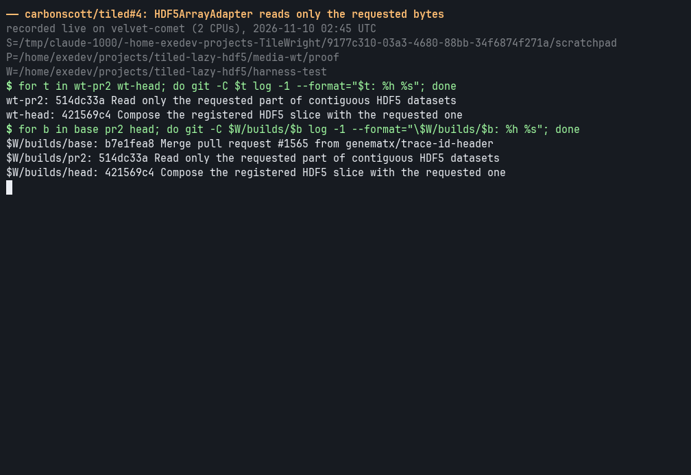
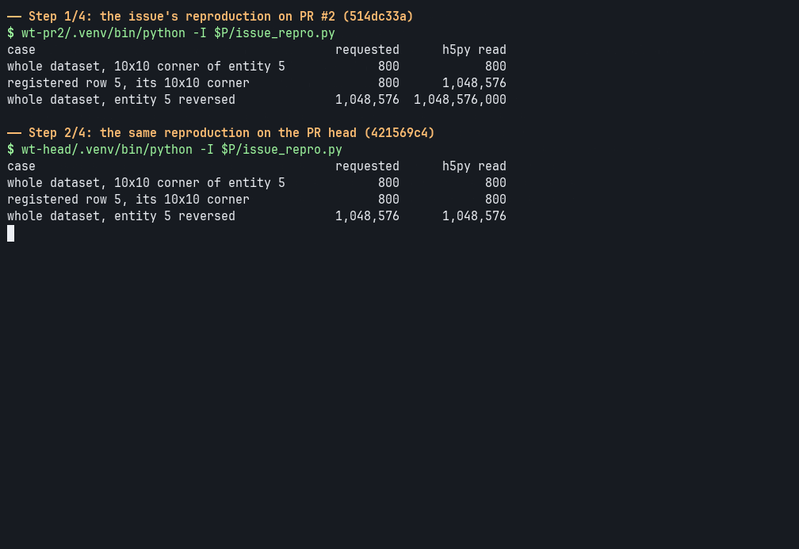
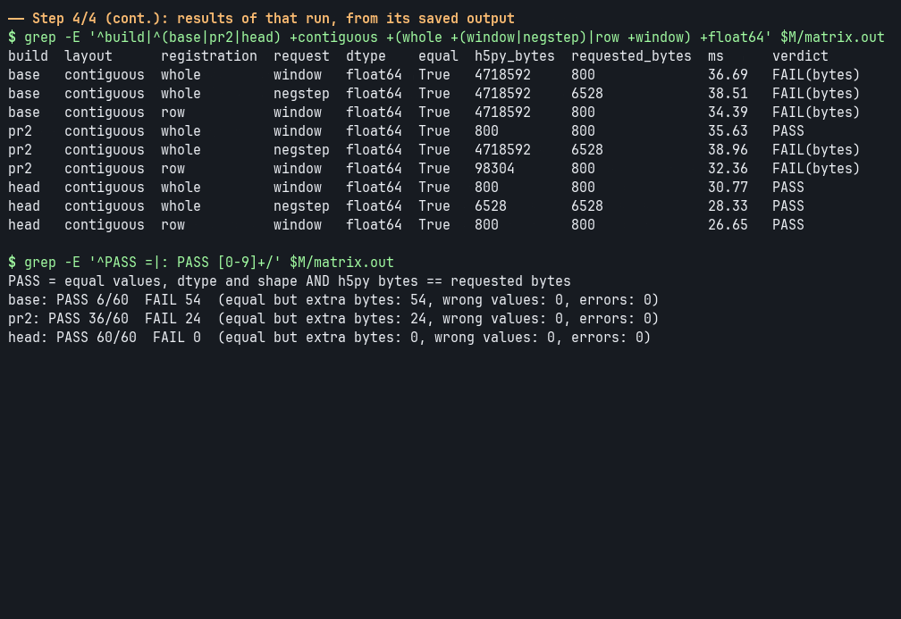
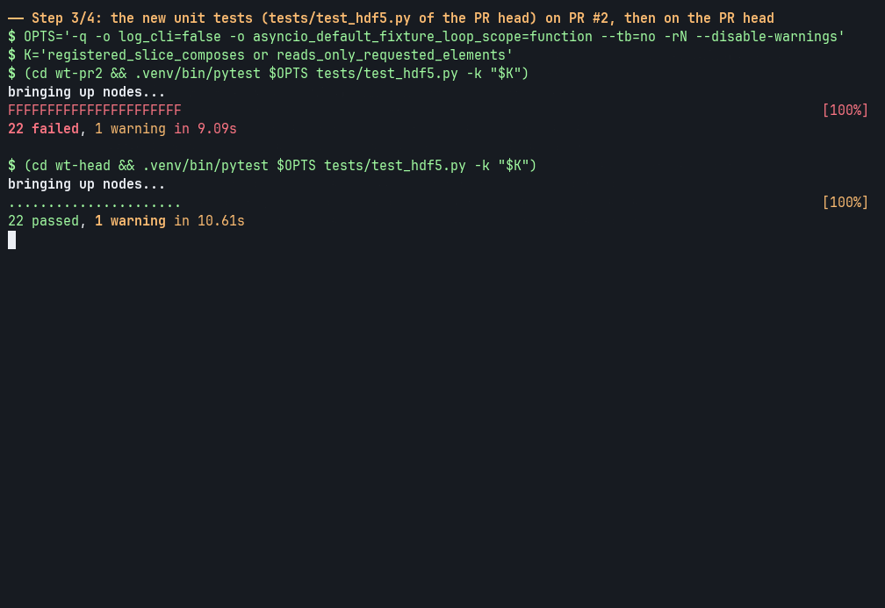
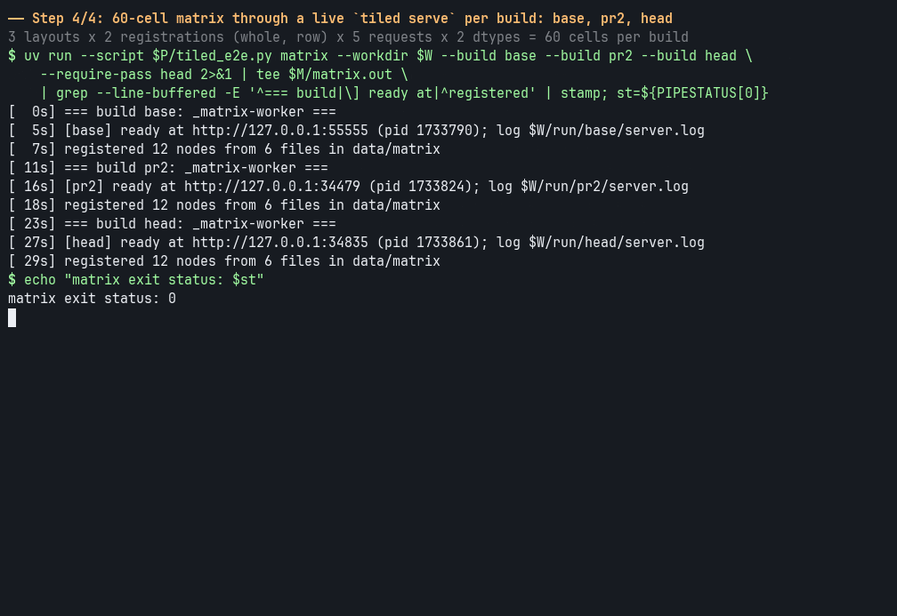

Closes #3.

Follow-up to #2, and stacked on it. #2 passes one requested slice down to h5py, but two kinds of request still read far more than they ask for: a slice of a dataset registered with a `slice` parameter reads the whole registered row, and a request with a negative step reads whole Dask chunks (all of a contiguous dataset). This makes h5py read exactly the requested elements in both cases.

### What changed

- **`HDF5ArrayAdapter`** keeps the registered selection (the `slice` and `squeeze` parameters, as one expanded `NDSlice` called `_stencil`, the name `ZarrArrayAdapter` uses) apart from the lazy Dask array of the whole dataset. `read` and `read_block` compose it with the requested slice and slice the Dask array once, which Dask fuses into each chunk's `getter`, so h5py receives the requested selection.
- **Negative steps.** Dask never fuses a negative step into `getter` (`dask.array.optimization.normalize_slice` raises `NotImplementedError` for `step < 0`), so on #2 even a plain `arr[5, ::-1]` reads whole chunks. The composed selection is now read forwards and reversed in memory with #2's `_forward_selection`; h5py never sees a negative step.
- **`compose_slices`** now composes reversed slices that run to the start of an axis (`arr[0:10][::-1]` composed to the empty `slice(9, -1, -1)`), and `NDSlice.expand_for_shape` takes `squeeze=` to express a squeeze as integer indices. The hypothesis strategy in `test_slicer.py` had an emptiness filter that never drew these slices; with it fixed, the property test finds a failing example on #2 and passes here.
- **Unchanged:** the Dask chunking and the number of file opens. When the catalog's structure no longer matches the file (a dataset that grew, or a reshape), the registered view is sliced in memory as before.
- **One small behaviour change:** `adapter.read()` on a squeezed scalar dataset returns a NumPy scalar instead of a 0-d array, because the squeeze is now an integer index. The server applies `numpy.asarray`, so HTTP responses are identical.

### Results

All runs below are on one exclusive Slurm node (S3DF `sdfmilan125`, AMD EPYC 7713, job 44053878), comparing three builds with identical dependencies: **base** = b7e1fea8 (#2's base), **#2** = 514dc33a, **this PR** = 421569c4. Python 3.12.12, dask 2026.8.0, h5py 3.16.0 (HDF5 2.0.0), numpy 2.5.4.

#### End-to-end matrix: 60/60 cells exact on this PR

Through a live `tiled serve` and the Python client, for each build: 3 layouts (contiguous, chunked, gzip) × 2 registrations (whole dataset; one row via the `slice` parameter) × 5 requests (whole entity, small window, strided, negative step, `read_block`) × 2 dtypes (float64, int16). Each cell is compared with an independent oracle (h5py + NumPy in the client process), and "h5py bytes" is what `h5py.Dataset.__getitem__` returned inside the server. A cell passes when the values, dtype and shape are equal **and** h5py returned exactly the requested bytes.

```
base: PASS 6/60  FAIL 54  (equal but extra bytes: 54, wrong values: 0, errors: 0)
pr2: PASS 36/60  FAIL 24  (equal but extra bytes: 24, wrong values: 0, errors: 0)
head: PASS 60/60  FAIL 0  (equal but extra bytes: 0, wrong values: 0, errors: 0)
```

Every build returns correct values in every cell; the failures are all extra bytes. #2's 24 are the 12 negative-step cells and the 12 window/strided cells on a registered row. A second run from a fresh clone, using only the commands under *Reproduce*, gave the same three tallies and the same 180 rows apart from timings. Full tables: [main run](https://raw.githubusercontent.com/carbonscott/tiled/proof-lazy-hdf5/results/matrix_main.txt), [fresh-clone run](https://raw.githubusercontent.com/carbonscott/tiled/proof-lazy-hdf5/results/matrix_fresh.txt).

#### Benchmarks: when it helps

1000 entities × 1 MiB float64 per file (1.05 GB). Medians of 20 cold and 20 warm requests per cell; cold = `posix_fadvise(DONTNEED)` on the file, verified empty with `mincore` before each request (300/300 verified); warm = the same request again. Builds ran one after another, each with its own server, with the same seeded draws; nothing else ran on the node.

| Scenario | Request | Build | h5py bytes / request | Warm (ms) | Cold (ms) |
|---|---|---|---:|---:|---:|
| contiguous stacked file | whole entity | base | 1000 MiB | 196.6 | 558.8 |
| | | #2 | 1 MiB | 32.0 | 34.0 |
| | | this PR | 1 MiB | 32.0 | 34.6 |
| chunks spanning 64 entities | whole entity | base | 64 MiB | 41.7 | 95.1 |
| | | #2 | 1 MiB | 32.0 | 35.7 |
| | | this PR | 1 MiB | 32.0 | 35.5 |
| chunks of one entity | whole entity | base | 1 MiB | 32.4 | 35.8 |
| | | #2 | 1 MiB | 34.2 | 37.4 |
| | | this PR | 1 MiB | 34.4 | 37.2 |
| compressed chunks (gzip, one entity) | whole entity | base | 1 MiB | 34.0 | 35.5 |
| | | #2 | 1 MiB | 35.4 | 37.2 |
| | | this PR | 1 MiB | 35.3 | 37.1 |
| registered row (contiguous) | 10×10 window | base | 1000 MiB | 190.7 | 554.7 |
| | | #2 | 1 MiB | 25.5 | 27.4 |
| | | this PR | 800 B | 24.9 | 26.4 |

**Where this PR is not faster.**
- Against #2, it is not faster on the contiguous file, chunks spanning many entities, chunks of one entity, or compressed chunks: a whole-entity request already reads exactly one entity on #2, and the differences (−0.3 to +0.6 ms) are within noise.
- On a registered row with a 10×10 window it reads 800 B instead of 1 MiB, but at this row size that saves only 0.6 ms warm and 1.0 ms cold (2–4%), at the edge of the noise (bootstrap 95% intervals −1.05 to −0.05 ms warm, −1.64 to −0.58 ms cold).
- Against base, it is slower on chunks of one entity (+2.0 ms warm, +1.4 ms cold) and compressed chunks (+1.3 ms warm, +1.7 ms cold), about 4–6%. #2 shows the same cost, so it comes with #2's `getter` read path rather than this change.

The saving grows with what #2 over-reads: the size of the registered row, or for a negative step, a whole chunk or the whole contiguous dataset (1,048,576,000 bytes read to serve 1,048,576 in [the issue's reproduction](https://github.com/carbonscott/tiled/issues/3)). Benchmark table as produced: [bench_main.md](https://raw.githubusercontent.com/carbonscott/tiled/proof-lazy-hdf5/results/bench_main.md).

#### Real datasets from a Tiled deployment: 8 of 8 equal

Nine arrays from eight public datasets registered on the SLAC Tiled test instance (tiled 0.2.10b2.dev493) were served straight from their source HDF5 files on S3DF by a local `tiled serve` running this PR's stock `HDF5ArrayAdapter` (mimetype `application/x-hdf5`, no plugin), and three slices of each (head, middle, tail; some strided) were compared element for element with the same slices fetched from the test instance. Five of the arrays are rows of stacked datasets registered with `slice="<row>"` (IIYAMA ×2, MARONE, LANGBEHN, LECOANET), which is the path this PR changes; the others are whole datasets. Layouts include contiguous, chunked, gzip and shuffle+gzip; dtypes float32, float64, int16, int32 and uint8.

```
slices equal (local stock adapter == test instance): 27/27; mismatches: 0; errors: 0; local != direct h5py: 0
datasets equal on every slice: 8/8 (required >= 5)
```

A negative control that perturbs one dataset's local copy fails as it should (24/27, `RESULT: FAIL`).

<details><summary>All 27 comparisons</summary>

| dataset key | array path | slice | shape | dtype | equal | test-instance URL |
|---|---|---|---|---|---|---|
| IIYAMA_GARNET_CALORIMETER_EVENTS | `IIYAMA_GARNET_CALORIMETER_EVENTS/IIYAMA_GARNET_CALORIMETER_EVENTS_29db5c3461a5f/raw` | `0:200,0:2` | 200x2 | float32 | yes | [link](https://lcls-data-portal.slac.stanford.edu/tiled-test/api/v1/array/full/IIYAMA_GARNET_CALORIMETER_EVENTS/IIYAMA_GARNET_CALORIMETER_EVENTS_29db5c3461a5f/raw?slice=0:200,0:2) |
| IIYAMA_GARNET_CALORIMETER_EVENTS | `IIYAMA_GARNET_CALORIMETER_EVENTS/IIYAMA_GARNET_CALORIMETER_EVENTS_29db5c3461a5f/raw` | `2100:2400:3,0:2` | 100x2 | float32 | yes | [link](https://lcls-data-portal.slac.stanford.edu/tiled-test/api/v1/array/full/IIYAMA_GARNET_CALORIMETER_EVENTS/IIYAMA_GARNET_CALORIMETER_EVENTS_29db5c3461a5f/raw?slice=2100:2400:3,0:2) |
| IIYAMA_GARNET_CALORIMETER_EVENTS | `IIYAMA_GARNET_CALORIMETER_EVENTS/IIYAMA_GARNET_CALORIMETER_EVENTS_29db5c3461a5f/raw` | `3000:4375,0:2` | 1375x2 | float32 | yes | [link](https://lcls-data-portal.slac.stanford.edu/tiled-test/api/v1/array/full/IIYAMA_GARNET_CALORIMETER_EVENTS/IIYAMA_GARNET_CALORIMETER_EVENTS_29db5c3461a5f/raw?slice=3000:4375,0:2) |
| IIYAMA_GARNET_CALORIMETER_EVENTS | `IIYAMA_GARNET_CALORIMETER_EVENTS/IIYAMA_GARNET_CALORIMETER_EVENTS_29db5c3461a5f/cluster` | `0:32,0:4` | 32x4 | float32 | yes | [link](https://lcls-data-portal.slac.stanford.edu/tiled-test/api/v1/array/full/IIYAMA_GARNET_CALORIMETER_EVENTS/IIYAMA_GARNET_CALORIMETER_EVENTS_29db5c3461a5f/cluster?slice=0:32,0:4) |
| IIYAMA_GARNET_CALORIMETER_EVENTS | `IIYAMA_GARNET_CALORIMETER_EVENTS/IIYAMA_GARNET_CALORIMETER_EVENTS_29db5c3461a5f/cluster` | `40:80,0:4` | 40x4 | float32 | yes | [link](https://lcls-data-portal.slac.stanford.edu/tiled-test/api/v1/array/full/IIYAMA_GARNET_CALORIMETER_EVENTS/IIYAMA_GARNET_CALORIMETER_EVENTS_29db5c3461a5f/cluster?slice=40:80,0:4) |
| IIYAMA_GARNET_CALORIMETER_EVENTS | `IIYAMA_GARNET_CALORIMETER_EVENTS/IIYAMA_GARNET_CALORIMETER_EVENTS_29db5c3461a5f/cluster` | `56:128,0:4` | 72x4 | float32 | yes | [link](https://lcls-data-portal.slac.stanford.edu/tiled-test/api/v1/array/full/IIYAMA_GARNET_CALORIMETER_EVENTS/IIYAMA_GARNET_CALORIMETER_EVENTS_29db5c3461a5f/cluster?slice=56:128,0:4) |
| MARONE_NEWBERRY_MEQ_WAVEFORMS | `MARONE_NEWBERRY_MEQ_WAVEFORMS/MARONE_NEWBERRY_MEQ_WAVEFORMS_633bfd241a7ab/rawWave` | `0:2,0:512,0:3` | 2x512x3 | float64 | yes | [link](https://lcls-data-portal.slac.stanford.edu/tiled-test/api/v1/array/full/MARONE_NEWBERRY_MEQ_WAVEFORMS/MARONE_NEWBERRY_MEQ_WAVEFORMS_633bfd241a7ab/rawWave?slice=0:2,0:512,0:3) |
| MARONE_NEWBERRY_MEQ_WAVEFORMS | `MARONE_NEWBERRY_MEQ_WAVEFORMS/MARONE_NEWBERRY_MEQ_WAVEFORMS_633bfd241a7ab/rawWave` | `2:4,1800:2300:2,0:3` | 2x250x3 | float64 | yes | [link](https://lcls-data-portal.slac.stanford.edu/tiled-test/api/v1/array/full/MARONE_NEWBERRY_MEQ_WAVEFORMS/MARONE_NEWBERRY_MEQ_WAVEFORMS_633bfd241a7ab/rawWave?slice=2:4,1800:2300:2,0:3) |
| MARONE_NEWBERRY_MEQ_WAVEFORMS | `MARONE_NEWBERRY_MEQ_WAVEFORMS/MARONE_NEWBERRY_MEQ_WAVEFORMS_633bfd241a7ab/rawWave` | `5:6,3584:4096,0:3` | 1x512x3 | float64 | yes | [link](https://lcls-data-portal.slac.stanford.edu/tiled-test/api/v1/array/full/MARONE_NEWBERRY_MEQ_WAVEFORMS/MARONE_NEWBERRY_MEQ_WAVEFORMS_633bfd241a7ab/rawWave?slice=5:6,3584:4096,0:3) |
| LANGBEHN_HELIUM_NANODROPLET_DIFFRACTION | `LANGBEHN_HELIUM_NANODROPLET_DIFFRACTION/LANGBEHN_HELIUM_NANODROPLET_DIFFRACTION_5b8ca7a2cc3ef/ScatImg_raw` | `0:64,0:256` | 64x256 | float32 | yes | [link](https://lcls-data-portal.slac.stanford.edu/tiled-test/api/v1/array/full/LANGBEHN_HELIUM_NANODROPLET_DIFFRACTION/LANGBEHN_HELIUM_NANODROPLET_DIFFRACTION_5b8ca7a2cc3ef/ScatImg_raw?slice=0:64,0:256) |
| LANGBEHN_HELIUM_NANODROPLET_DIFFRACTION | `LANGBEHN_HELIUM_NANODROPLET_DIFFRACTION/LANGBEHN_HELIUM_NANODROPLET_DIFFRACTION_5b8ca7a2cc3ef/ScatImg_raw` | `480:560:2,400:700:3` | 40x100 | float32 | yes | [link](https://lcls-data-portal.slac.stanford.edu/tiled-test/api/v1/array/full/LANGBEHN_HELIUM_NANODROPLET_DIFFRACTION/LANGBEHN_HELIUM_NANODROPLET_DIFFRACTION_5b8ca7a2cc3ef/ScatImg_raw?slice=480:560:2,400:700:3) |
| LANGBEHN_HELIUM_NANODROPLET_DIFFRACTION | `LANGBEHN_HELIUM_NANODROPLET_DIFFRACTION/LANGBEHN_HELIUM_NANODROPLET_DIFFRACTION_5b8ca7a2cc3ef/ScatImg_raw` | `1000:1036,900:1036` | 36x136 | float32 | yes | [link](https://lcls-data-portal.slac.stanford.edu/tiled-test/api/v1/array/full/LANGBEHN_HELIUM_NANODROPLET_DIFFRACTION/LANGBEHN_HELIUM_NANODROPLET_DIFFRACTION_5b8ca7a2cc3ef/ScatImg_raw?slice=1000:1036,900:1036) |
| LECOANET_KELVIN_HELMHOLTZ_BENCHMARK | `LECOANET_KELVIN_HELMHOLTZ_BENCHMARK/LECOANET_KELVIN_HELMHOLTZ_BENCHMARK_4e717e21f09f5/c` | `0:100,0:400` | 100x400 | float64 | yes | [link](https://lcls-data-portal.slac.stanford.edu/tiled-test/api/v1/array/full/LECOANET_KELVIN_HELMHOLTZ_BENCHMARK/LECOANET_KELVIN_HELMHOLTZ_BENCHMARK_4e717e21f09f5/c?slice=0:100,0:400) |
| LECOANET_KELVIN_HELMHOLTZ_BENCHMARK | `LECOANET_KELVIN_HELMHOLTZ_BENCHMARK/LECOANET_KELVIN_HELMHOLTZ_BENCHMARK_4e717e21f09f5/c` | `1500:1600,3000:3500` | 100x500 | float64 | yes | [link](https://lcls-data-portal.slac.stanford.edu/tiled-test/api/v1/array/full/LECOANET_KELVIN_HELMHOLTZ_BENCHMARK/LECOANET_KELVIN_HELMHOLTZ_BENCHMARK_4e717e21f09f5/c?slice=1500:1600,3000:3500) |
| LECOANET_KELVIN_HELMHOLTZ_BENCHMARK | `LECOANET_KELVIN_HELMHOLTZ_BENCHMARK/LECOANET_KELVIN_HELMHOLTZ_BENCHMARK_4e717e21f09f5/c` | `2972:3072,5744:6144` | 100x400 | float64 | yes | [link](https://lcls-data-portal.slac.stanford.edu/tiled-test/api/v1/array/full/LECOANET_KELVIN_HELMHOLTZ_BENCHMARK/LECOANET_KELVIN_HELMHOLTZ_BENCHMARK_4e717e21f09f5/c?slice=2972:3072,5744:6144) |
| AJO_FRANKLIN_IMPERIAL_VALLEY_DAS | `AJO_FRANKLIN_IMPERIAL_VALLEY_DAS/AJO_FRANKLIN_IMPERIAL_VALLEY_DAS_fd9617a5fec8d/acoustic` | `0:100,0:1000` | 100x1000 | int16 | yes | [link](https://lcls-data-portal.slac.stanford.edu/tiled-test/api/v1/array/full/AJO_FRANKLIN_IMPERIAL_VALLEY_DAS/AJO_FRANKLIN_IMPERIAL_VALLEY_DAS_fd9617a5fec8d/acoustic?slice=0:100,0:1000) |
| AJO_FRANKLIN_IMPERIAL_VALLEY_DAS | `AJO_FRANKLIN_IMPERIAL_VALLEY_DAS/AJO_FRANKLIN_IMPERIAL_VALLEY_DAS_fd9617a5fec8d/acoustic` | `14950:15050,3000:4000` | 100x1000 | int16 | yes | [link](https://lcls-data-portal.slac.stanford.edu/tiled-test/api/v1/array/full/AJO_FRANKLIN_IMPERIAL_VALLEY_DAS/AJO_FRANKLIN_IMPERIAL_VALLEY_DAS_fd9617a5fec8d/acoustic?slice=14950:15050,3000:4000) |
| AJO_FRANKLIN_IMPERIAL_VALLEY_DAS | `AJO_FRANKLIN_IMPERIAL_VALLEY_DAS/AJO_FRANKLIN_IMPERIAL_VALLEY_DAS_fd9617a5fec8d/acoustic` | `29900:30000,5912:6912` | 100x1000 | int16 | yes | [link](https://lcls-data-portal.slac.stanford.edu/tiled-test/api/v1/array/full/AJO_FRANKLIN_IMPERIAL_VALLEY_DAS/AJO_FRANKLIN_IMPERIAL_VALLEY_DAS_fd9617a5fec8d/acoustic?slice=29900:30000,5912:6912) |
| MAYNARD_CASELY_BUTANE_DIFFRACTION | `MAYNARD_CASELY_BUTANE_DIFFRACTION/MAYNARD_CASELY_BUTANE_DIFFRACTION_a9b62571aeb9e/hmm_xy` | `0:1,0:64,0:128` | 1x64x128 | int32 | yes | [link](https://lcls-data-portal.slac.stanford.edu/tiled-test/api/v1/array/full/MAYNARD_CASELY_BUTANE_DIFFRACTION/MAYNARD_CASELY_BUTANE_DIFFRACTION_a9b62571aeb9e/hmm_xy?slice=0:1,0:64,0:128) |
| MAYNARD_CASELY_BUTANE_DIFFRACTION | `MAYNARD_CASELY_BUTANE_DIFFRACTION/MAYNARD_CASELY_BUTANE_DIFFRACTION_a9b62571aeb9e/hmm_xy` | `2:4,32:96,400:600` | 2x64x200 | int32 | yes | [link](https://lcls-data-portal.slac.stanford.edu/tiled-test/api/v1/array/full/MAYNARD_CASELY_BUTANE_DIFFRACTION/MAYNARD_CASELY_BUTANE_DIFFRACTION_a9b62571aeb9e/hmm_xy?slice=2:4,32:96,400:600) |
| MAYNARD_CASELY_BUTANE_DIFFRACTION | `MAYNARD_CASELY_BUTANE_DIFFRACTION/MAYNARD_CASELY_BUTANE_DIFFRACTION_a9b62571aeb9e/hmm_xy` | `5:6,64:128,840:968` | 1x64x128 | int32 | yes | [link](https://lcls-data-portal.slac.stanford.edu/tiled-test/api/v1/array/full/MAYNARD_CASELY_BUTANE_DIFFRACTION/MAYNARD_CASELY_BUTANE_DIFFRACTION_a9b62571aeb9e/hmm_xy?slice=5:6,64:128,840:968) |
| SCHWENK_RIVERPIXELS | `SCHWENK_RIVERPIXELS/SCHWENK_RIVERPIXELS_7635b303ab672/gswmo` | `0:32,0:64` | 32x64 | uint8 | yes | [link](https://lcls-data-portal.slac.stanford.edu/tiled-test/api/v1/array/full/SCHWENK_RIVERPIXELS/SCHWENK_RIVERPIXELS_7635b303ab672/gswmo?slice=0:32,0:64) |
| SCHWENK_RIVERPIXELS | `SCHWENK_RIVERPIXELS/SCHWENK_RIVERPIXELS_7635b303ab672/gswmo` | `100:160:2,60:200` | 30x140 | uint8 | yes | [link](https://lcls-data-portal.slac.stanford.edu/tiled-test/api/v1/array/full/SCHWENK_RIVERPIXELS/SCHWENK_RIVERPIXELS_7635b303ab672/gswmo?slice=100:160:2,60:200) |
| SCHWENK_RIVERPIXELS | `SCHWENK_RIVERPIXELS/SCHWENK_RIVERPIXELS_7635b303ab672/gswmo` | `224:256,192:256` | 32x64 | uint8 | yes | [link](https://lcls-data-portal.slac.stanford.edu/tiled-test/api/v1/array/full/SCHWENK_RIVERPIXELS/SCHWENK_RIVERPIXELS_7635b303ab672/gswmo?slice=224:256,192:256) |
| BAKER_CODAS_OLIKTOK_POINT | `BAKER_CODAS_OLIKTOK_POINT/BAKER_CODAS_OLIKTOK_POINT_787f74a34b72f/strain_rate` | `0:5000` | 5000 | float32 | yes | [link](https://lcls-data-portal.slac.stanford.edu/tiled-test/api/v1/array/full/BAKER_CODAS_OLIKTOK_POINT/BAKER_CODAS_OLIKTOK_POINT_787f74a34b72f/strain_rate?slice=0:5000) |
| BAKER_CODAS_OLIKTOK_POINT | `BAKER_CODAS_OLIKTOK_POINT/BAKER_CODAS_OLIKTOK_POINT_787f74a34b72f/strain_rate` | `179000:181000:3` | 667 | float32 | yes | [link](https://lcls-data-portal.slac.stanford.edu/tiled-test/api/v1/array/full/BAKER_CODAS_OLIKTOK_POINT/BAKER_CODAS_OLIKTOK_POINT_787f74a34b72f/strain_rate?slice=179000:181000:3) |
| BAKER_CODAS_OLIKTOK_POINT | `BAKER_CODAS_OLIKTOK_POINT/BAKER_CODAS_OLIKTOK_POINT_787f74a34b72f/strain_rate` | `355000:360000` | 5000 | float32 | yes | [link](https://lcls-data-portal.slac.stanford.edu/tiled-test/api/v1/array/full/BAKER_CODAS_OLIKTOK_POINT/BAKER_CODAS_OLIKTOK_POINT_787f74a34b72f/strain_rate?slice=355000:360000) |

</details>

### The proof, running

Recorded live in one take (asciinema, rendered with agg; each step stays on screen for at least 6 s): the issue's reproduction on #2, the same on this PR, the new unit tests on both, and the 60-cell matrix through a live `tiled serve` for base, #2 and this PR.



MP4 of the same recording: [demo.mp4](https://raw.githubusercontent.com/carbonscott/tiled/proof-lazy-hdf5/media/demo.mp4) (122.8 s). Script: [demo.sh](https://raw.githubusercontent.com/carbonscott/tiled/proof-lazy-hdf5/media/demo.sh); raw cast: [demo.cast](https://raw.githubusercontent.com/carbonscott/tiled/proof-lazy-hdf5/media/demo.cast).





<details><summary>More screenshots</summary>





</details>

### Tests

- New: `test_registered_slice_composes_with_requested_slice` (4 layouts × 4 registrations, every request shape and every `read_block`, asserting h5py bytes `==` result bytes) and `test_registered_slice_composes_over_http`. #2's `<=` assertion in `test_reads_only_requested_elements` is now `==`. With only `tests/test_hdf5.py` taken from this branch, 22 tests fail on #2 (514dc33a), all on byte counts.
- `tests/test_hdf5.py`: 71 passed (421569c4).
- The other test files that touch HDF5 (`test_catalog`, `test_container_files`, `test_deep_search`, `test_directory_walker`, `test_container_fields`, `test_export`, `test_register`, `test_simple_server`, `test_sync`, `test_tokenize`): 193 passed, 50 skipped, 3 xfailed.
- Rebased with #2 onto bluesky/tiled `main` (49fe22da): `tests/test_hdf5.py` 71 passed; the other HDF5 files 196 passed, 53 skipped, 3 xfailed, the same as unmodified `main` (48 and 196/53/3 passed/skipped/xfailed). No failures on either.
- `ruff check` and `ruff format --check` are clean.

### Reproduce

The proof scripts live on the orphan branch [`proof-lazy-hdf5`](https://github.com/carbonscott/tiled/tree/proof-lazy-hdf5), not in this PR. On Linux with `git` and `uv`; only `setup` needs the network. On a Slurm cluster, run `setup` on a login node and each later step as `srun --ntasks=1 --cpus-per-task=8 --mem=32G <step>` (add `--jobid=<id> --overlap` to run inside a held allocation).

```sh
git clone --branch hdf5-compose-registered-slice https://github.com/carbonscott/tiled tiled-pr && cd tiled-pr
git show origin/proof-lazy-hdf5:proof/tiled_e2e.py > ../tiled_e2e.py && cd ..
W=$PWD/tiled-e2e
uv run --script tiled_e2e.py setup --workdir "$W" \
    --build base=b7e1fea8570391852a52e06dada39397e24e2335 \
    --build pr2=514dc33a66430b053d1338801da19eb3154b993b \
    --build head=$(git -C tiled-pr rev-parse HEAD)
export UV_OFFLINE=1   # nothing after setup touches the network
uv run --script tiled_e2e.py data   --workdir "$W" --kind matrix
uv run --script tiled_e2e.py matrix --workdir "$W"        # 3 x 60 cells; exits 1 if head has any FAIL
uv run --script tiled_e2e.py data   --workdir "$W" --kind bench
uv run --script tiled_e2e.py bench  --workdir "$W" --requests 20
# results: $W/results/matrix.{txt,tsv,json} and $W/results/bench.{md,json}
```

### Checklist
- [x] Add a Changelog entry
- [x] Add the ticket number which this PR closes to the comment section

🤖 Generated with [Claude Code](https://claude.com/claude-code)

https://claude.ai/code/session_01LXjGSbZpKujVHMN9pAKtp2
